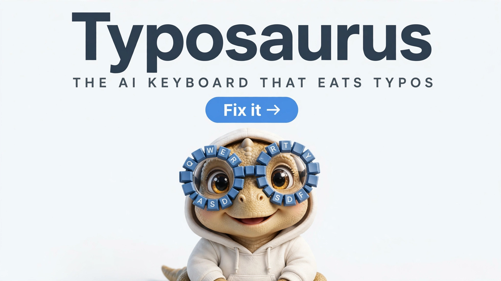
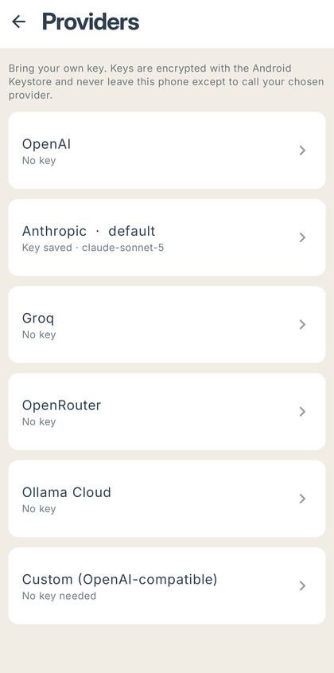
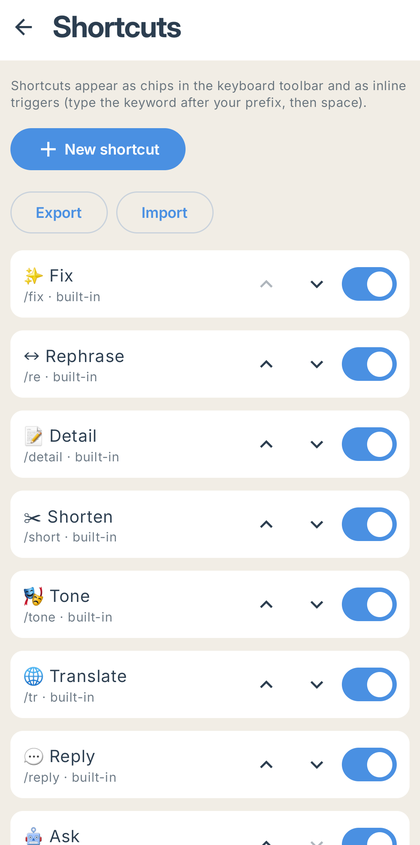
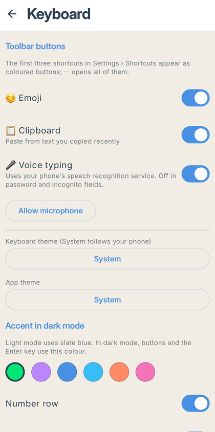
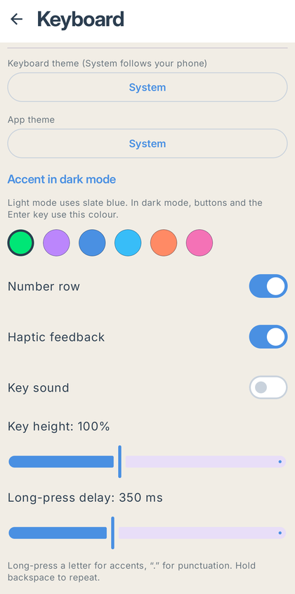
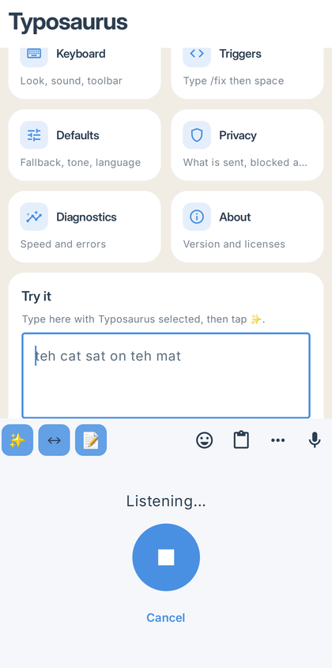
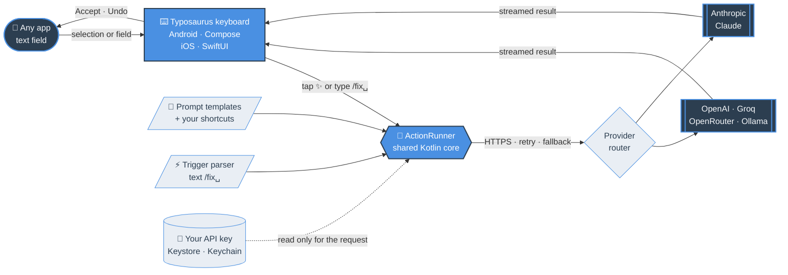

<p align="center">
  
</p>

<p align="center">
  <br>
  <b>Typosaurus</b> — an AI keyboard for Android (and iOS) that fixes, rewrites, translates and replies in any app.<br>
  Bring your own key: <b>OpenAI · Anthropic · Groq · OpenRouter · Ollama Cloud</b> or any OpenAI-compatible endpoint.
</p>

<p align="center">
  <a href="https://github.com/Akash-Gunasekar/typosaurus/releases/latest/download/typosaurus.apk"><b>⬇ Download for Android</b></a>
  &nbsp;·&nbsp;
  <a href="downloads/ios/">iOS: build from source</a>
  &nbsp;·&nbsp;
  <a href="https://github.com/Akash-Gunasekar/typosaurus/releases">All releases</a>
</p>

---

## See it in action

https://github.com/user-attachments/assets/71680184-58f6-41c0-93cf-9ed8924164b7

## Screenshots

<table>
  <tr>
    <td align="center"><br><sub>Keyboard with one-tap AI buttons</sub></td>
    <td align="center"><br><sub>⋯ every shortcut</sub></td>
    <td align="center"><br><sub>Emoji panel</sub></td>
  </tr>
  <tr>
    <td align="center"><br><sub>Home</sub></td>
    <td align="center"><br><sub>Bring your own key: 5 providers + custom</sub></td>
    <td align="center"><br><sub>Shortcuts: reorder, toggle, add your own</sub></td>
  </tr>
  <tr>
    <td align="center"><br><sub>Toolbar buttons, 🎤 voice typing, theme</sub></td>
    <td align="center"><br><sub>Accent, haptics, sound, key height</sub></td>
    <td align="center"><br><sub>🎤 Voice typing</sub></td>
  </tr>
</table>

## What it does

| | |
|---|---|
| ✨ **One-tap AI** | Fix, Rephrase, Detail, Shorten, Tone, Translate, Reply, Ask — on the selection or the whole field |
| ⚡ **Inline triggers** | Type `pls send report tmrw /fix␣` or `good morning /tr:ta␣` and the text is rewritten in place |
| 🧩 **Your own shortcuts** | Custom prompts with their own emoji, keyword, provider, model and temperature; import/export as JSON |
| 👀 **Preview first** | Results stream into a preview: Accept, Retry, Copy or Cancel, then a 5-second Undo |
| 🔤 **Word suggestions** | English completions above the keys as you type, with a pop-up letter on every key press; ‹ brings back the AI buttons. Nothing you type is learned or saved |
| 😊 **Emoji, 📋 clipboard, 🎤 voice** | Emoji panel, in-memory clipboard history (API keys and passwords are masked, never kept), voice typing |
| 🔒 **Private by design** | Text leaves the phone only when you tap an action, straight to *your* provider over HTTPS. Never from password, PIN or incognito fields, or apps you block. No Typosaurus server, no logs |
| 🪶 **Small and fast** | 3.3 MB release APK, opens in ~0.4 s; Inter typeface bundled as a 100 KB variable font |

## Install (Android)

**Easiest:** download the signed APK from the [latest release](https://github.com/Akash-Gunasekar/typosaurus/releases/latest) — step-by-step in [downloads/android](downloads/android/).

To build it yourself instead:

Requires JDK 17+ and the Android SDK (compileSdk 35).

```bash
./gradlew assembleRelease          # app/build/outputs/apk/release/app-release.apk (~3.4 MB)
adb install -r app/build/outputs/apk/release/app-release.apk
```

Open **Typosaurus**: setup walks through enabling the keyboard, selecting it, the privacy notice and adding a key.
Without the Play upload key, local release builds are signed with the debug key — fine for testing, never upload them.

From the command line instead:

```bash
adb shell ime enable com.example.aikeyboard/.ime.AiKeyboardService
adb shell ime set    com.example.aikeyboard/.ime.AiKeyboardService
```

## iOS

The shared Kotlin core (prompts, provider adapters, retries, triggers) is compiled into a `TyposaurusCore`
framework and used by a SwiftUI app and keyboard extension in [`ios/`](ios). Building needs a Mac with Xcode 16+:

```bash
brew install xcodegen
cd ios && xcodegen && open Typosaurus.xcodeproj
```

Set your team under *Signing*, run the **Typosaurus** scheme, then on the iPhone: *Settings › General › Keyboard ›
Keyboards › Add New Keyboard › Typosaurus* and turn on **Allow Full Access** (needed to reach the AI provider).
The app stores keys in a shared Keychain group and settings in an App Group, in the same JSON format as Android.

iOS keyboards can't use the microphone or read other apps' text beyond the current field, so voice typing and
clipboard history are Android-only; iOS has the toolbar, all AI shortcuts, inline triggers, preview, Accept and Undo.

## How it works



| Module | What | Platforms |
|---|---|---|
| `:core` | Providers (OpenAI-compatible + Anthropic, SSE streaming, retry/fallback), prompt rendering, trigger parser, `ActionRunner` state machine, local metrics, `Assistant` facade for iOS | Kotlin Multiplatform: JVM/Android (OkHttp) and iOS (NSURLSession via Ktor Darwin) |
| `:data` | DataStore settings, Android Keystore-encrypted API keys, 24 h model cache, local usage metrics | Android |
| `:app` | Keyboard service, Compose keyboard (toolbar, emoji, clipboard, voice, preview), settings app, `PROCESS_TEXT` "Typosaurus Fix" menu | Android |
| `ios/` | SwiftUI setup app + keyboard extension using `TyposaurusCore` | iOS 16+ |

## Development

```bash
./gradlew -PcoreOnly=true :core:jvmTest   # shared core only — no Android SDK needed
./gradlew lintDebug :core:jvmTest :data:testDebugUnitTest :app:testDebugUnitTest assembleDebug
./gradlew connectedDebugAndroidTest       # emulator/device: IME registration smoke test
```

CI (GitHub Actions) runs lint and all unit tests, a dependency vulnerability scan, an emulator test, and a macOS job
that compiles the shared core for iOS and builds the app and keyboard extension for the simulator.

### Design decisions

- **Prompt-injection hardening:** user text is wrapped in `<text>…</text>` and prompts say to treat it as data.
- **Retries never happen after text has streamed** (no duplicated output): one retry (429 honours `Retry-After` up to 5 s, 5xx after 1 s), then the optional fallback provider.
- **Auto-apply falls back to preview** when a result is over 2× the input or was cut off by the token limit.
- **Per-model parameters:** Claude models never get `temperature`; OpenAI reasoning models (`o*`, `gpt-5`, `gpt-6`) get `max_completion_tokens` and no temperature. Override per model in *Settings › Providers › Advanced*.
- **Inline triggers** only fire when the token starts the text or follows whitespace, so `example.com/fix ` is safe.
- Plain `http://` is allowed only for `localhost`, `127.0.0.1` and `10.0.2.2` (local Ollama).

## License

[MIT](LICENSE) © 2026 Akash Gunasekar. The bundled Inter typeface is under the [SIL Open Font License](branding/Inter-OFL.txt).

---

<p align="center">Made with ❤️ by <b>Akash Gunasekar</b></p>
